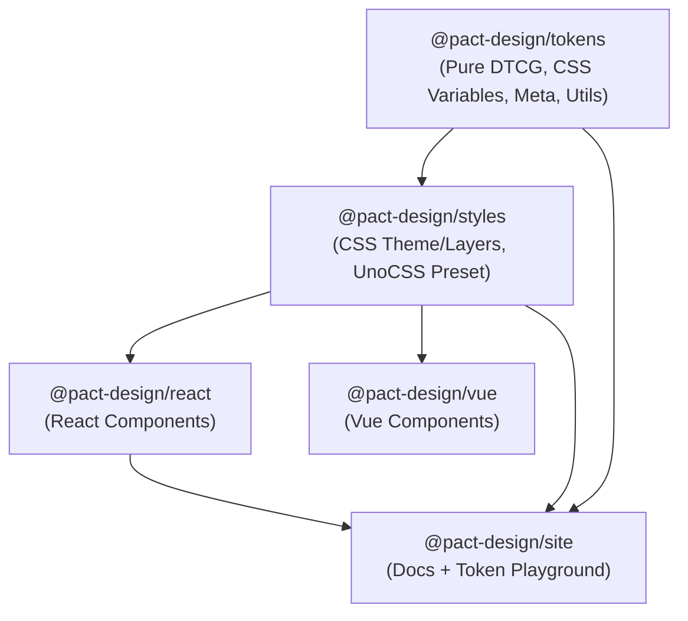

# Pact Design — Monorepo Structure & Architecture Decision

This document records the repository structure decision for **Pact Design** as it expands from a design-token library with a documentation site into a multi-package design system (`tokens`, `styles`, `react`, `vue`, and `site`).

---

## 1. Decision Summary

We adopt the **Standard `packages/*` Monorepo Layout** managed by **`pnpm` workspaces** inside a **single Git repository**:

- **Root directory (`Pact-Design/`)**: Strictly a private workspace orchestrator (`"private": true`) managing repo-wide scripts, linting, and lockfiles—never published to npm.
- **`packages/*`**: Contains all **publishable** npm packages (`@pact-design/tokens`, `@pact-design/styles`, `@pact-design/react`, `@pact-design/vue`).
- **`site/` & `docs/`**: Contains **internal/non-published** documentation specifications (`docs/`) and the interactive web application (`site/`).

---

## 2. Target Repository Structure

```txt
Pact-Design/
├── package.json                 # {"private": true} — Workspace scripts & shared devDependencies (ESLint)
├── pnpm-workspace.yaml          # Workspace package discovery: ['site', 'packages/*']
├── pnpm-lock.yaml               # Unified lockfile for the entire monorepo
├── .npmrc                       # Workspace configuration (strict pnpm linking)
├── eslint.config.js             # Unified flat ESLint configuration
├── docs/                        # Shared W3C DTCG & system specification MDX files
│   ├── spec/                    # Interactive documentation MDX pages
│   ├── token.md                 # Token architecture reference
│   ├── roadmap.md               # Project roadmap
│   └── repo-structure.md        # Monorepo architecture decision record (this file)
├── site/                        # @pact-design/site — Online docs & Token Playground ("private": true)
│   ├── package.json
│   ├── vite.config.js
│   ├── uno.config.js
│   └── src/
└── packages/                    # All publishable npm packages live here
    ├── tokens/                  # @pact-design/tokens
    │   ├── package.json         # exports: "./css", "./meta", "./src/*", "./utils/*"
    │   ├── src/                 # W3C DTCG 2025.10 TypeScript DSL (dsl, global, system, component)
    │   ├── scripts/             # Style Dictionary config & CSS/metadata formats
    │   ├── utils/               # Isomorphic color, APCA/WCAG contrast, and DTCG token utilities
    │   ├── test/                # Automated APCA contrast & token contract tests
    │   └── build/               # Generated outputs (css/_variables.css, meta/tokens.json)
    ├── styles/                  # @pact-design/styles — Web styling layer
    │   ├── package.json         # exports: "./css", "./css/theme", "./uno"
    │   ├── src/                 # Theme CSS (color-scheme) & UnoCSS preset rules/generator
    │   ├── scripts/             # Composed CSS layer & UnoCSS preset builder
    │   ├── test/                # CSS layer & UnoCSS build contract tests
    │   └── build/               # Generated outputs (css/index.css, css/theme.css, uno/preset.{js,d.ts})
    ├── react/                   # @pact-design/react — React component library
    │   ├── package.json
    │   └── src/
    └── vue/                     # @pact-design/vue — Vue component library
        ├── package.json
        └── src/
```

---

## 3. Why We Chose This Structure

### 3.1 Clear Boundary Between Publishable Packages and Internal Apps

Grouping all publishable artifacts under `packages/*` while keeping `site/` and `docs/` outside `packages/*` makes it immediately obvious what gets published to npm vs. what is internal infrastructure. Release and versioning tools (such as Changesets) and CI publish pipelines can target `packages/*` with a single glob without accidentally publishing the documentation site.

### 3.2 Private Workspace Root (Eliminating the "Root-as-Package" Anti-Pattern)

Previously, the root `package.json` acted as both the monorepo root and the published `pact-design` package, while `site/` depended back on the root via `"pact-design": "workspace:*"`. Moving the token library into `packages/tokens` and marking the root `package.json` as `"private": true` resolves several issues:

- **No dependency leakage**: Repo-wide dev tools (like `eslint` and `@stylistic/eslint-plugin`) stay in the root `devDependencies` and can never leak into a published package's runtime `dependencies`.
- **No parent-child dependency cycles**: Workspace children (`site`, `react`, `vue`) depend on a sibling (`@pact-design/tokens`), not on their own workspace root.
- **Clean `npm publish` surface**: Each package in `packages/*` defines its own `"files"` and `"exports"` without risking bundling root configs, `docs/`, or `site/`.

### 3.3 Separation of `@pact-design/tokens` and `@pact-design/styles`

Rather than mixing web-specific theme rules and UnoCSS presets into the pure design-token compiler, responsibilities are cleanly split across two foundation packages:

- **`@pact-design/tokens` (`packages/tokens`)**:
  - TypeScript token DSL definitions (`src/dsl/`, `src/global/`, `src/system/`, `src/component/`)
  - Style Dictionary v5 build pipeline (`scripts/build.ts`, `scripts/sd.config.ts`)
  - Isomorphic utilities (`utils/color.js`, `utils/contrast.js`, `utils/token.js`, `utils/helper.js`)
  - Automated verification gates (`test/contrast.test.js`, `test/build-contract.test.js`)
  - Raw distribution (`build/css/_variables.css`, `build/meta/tokens.json`) exported via `@pact-design/tokens/css`, `@pact-design/tokens/meta`, `@pact-design/tokens/src/*`, and `@pact-design/tokens/utils/*`
- **`@pact-design/styles` (`packages/styles`)**:
  - Web theme stylesheet (`src/css/theme.css`) setting `color-scheme: light` / `dark`
  - UnoCSS theme rules and generator (`src/uno/rules.ts`, `src/uno/preset.ts`)
  - Build script (`scripts/build.ts`) and build-contract tests (`test/build-contract.test.js`)
  - Compiled web outputs (`build/css/index.css`, `build/css/theme.css`, `build/uno/preset.{js,d.ts}`) exported via `@pact-design/styles/css`, `@pact-design/styles/css/theme`, and `@pact-design/styles/uno`

This allows `@pact-design/react`, `@pact-design/vue`, and `pact-site` to consume layered CSS and UnoCSS presets from `@pact-design/styles` while keeping `@pact-design/tokens` framework- and bundler-agnostic.

### 3.4 Single Git Repository vs. Multi-Repo / Submodules

All packages (`site`, `packages/tokens`, `packages/styles`, `packages/react`, `packages/vue`) live inside **one Git repository** (`Pact-Design/.git`) rather than separate Git repositories or submodules:

- **Atomic changes**: A single pull request can add a new token in `packages/tokens`, map UnoCSS/CSS rules in `packages/styles`, consume them in `packages/react` and `packages/vue`, and document them in `site/` and `docs/`.
- **Single lockfile**: One `pnpm-lock.yaml` at the root ensures consistent dependency versions (React, Vite, UnoCSS, ESLint) across the entire workspace.
- **Zero-publish local linking**: Changes in `packages/tokens` and `packages/styles` are immediately available to `packages/react`, `packages/vue`, and `site/` via `"workspace:*"`.

### 3.5 Lowercase Directory Naming for Cross-OS Safety

All workspace package directories use strict lowercase names (`packages/tokens`, `packages/styles`, `packages/react`, `packages/vue`). While macOS uses a case-insensitive filesystem by default, Linux CI/CD runners and production build containers are strictly case-sensitive. Lowercase naming prevents broken import paths across environments.

---

## 4. Package Dependency Graph & Scoping

All workspace packages share the `@pact-design/*` namespace:



| Package | Directory | Published to npm? | Internal Dependencies |
| :--- | :--- | :---: | :--- |
| `@pact-design/tokens` | `packages/tokens` | Yes | None |
| `@pact-design/styles` | `packages/styles` | Yes | `@pact-design/tokens` (`workspace:*`) |
| `@pact-design/react` | `packages/react` | Yes | `@pact-design/styles` (`workspace:*`) |
| `@pact-design/vue` | `packages/vue` | Yes | `@pact-design/styles` (`workspace:*`) |
| `@pact-design/site` | `site` | No (`private: true`) | `@pact-design/tokens`, `@pact-design/styles`, `@pact-design/react` (`workspace:*`) |

---

## 5. Workspace Configuration Standards

### 5.1 `pnpm-workspace.yaml`

```yaml
packages:
  - 'site'
  - 'packages/*'
```

### 5.2 Root `package.json`

The root `package.json` is strictly an orchestrator:

```json
{
  "name": "pact-design-monorepo",
  "private": true,
  "type": "module",
  "scripts": {
    "prepare": "husky",
    "build": "pnpm build:tokens && pnpm build:styles && pnpm --filter pact-site build",
    "build:tokens": "pnpm --filter @pact-design/tokens build",
    "build:styles": "pnpm --filter @pact-design/styles build",
    "build:sd": "pnpm --filter @pact-design/tokens build:sd",
    "pretest": "pnpm build:tokens && pnpm build:styles",
    "test": "pnpm -r test",
    "lint": "eslint .",
    "typecheck": "pnpm -r typecheck",
    "site:dev": "pnpm --filter pact-site dev",
    "site:build": "pnpm build:tokens && pnpm build:styles && pnpm --filter pact-site build",
    "site:preview": "pnpm --filter pact-site preview"
  },
  "devDependencies": {
    "@eslint/js": "^10.0.1",
    "@stylistic/eslint-plugin": "^5.10.0",
    "eslint": "^10.8.1"
  }
}
```

### 5.3 `.npmrc`

Avoid `node-linker=hoisted` so `pnpm` enforces strict package boundaries (preventing `react`, `vue`, or `site` from accidentally importing undeclared phantom dependencies):

```ini
auto-install-peers=true
```

---

## 6. Monorepo Tooling Strategy (Why Not Nx Today?)

### Current Stage: Native `pnpm` Workspaces

We intentionally avoid heavy monorepo orchestrators like **Nx** at this stage:

- **Fast builds**: Building `@pact-design/tokens` (Style Dictionary + APCA contrast test suite) takes `<1s`. Distributed task caching from Nx adds configuration overhead (`nx.json`, `.nx/` cache daemon) without meaningful time savings.
- **Simple topological graph**: `pnpm --filter` and `pnpm -r` natively handle dependency-ordered execution across `@pact-design/tokens` → `@pact-design/styles` → `@pact-design/{react,vue,site}`.

### Future Tooling Milestones

1. **When publishing packages to npm → Add [Changesets (`@changesets/cli`)](https://github.com/changesets/changesets)**:
   Manages semantic versioning, changelogs, and coordinated releases across `@pact-design/tokens`, `@pact-design/styles`, `@pact-design/react`, and `@pact-design/vue`.
2. **When total build/test times exceed ~30–60s → Add [Turborepo](https://turbo.build/)**:
   If building `tokens` + `styles` + `react` + `vue` + `site` grows slow in CI, add a lightweight `turbo.json` on top of `pnpm` workspaces for task pipelines (`"dependsOn": ["^build"]`) and local/remote build caching.

---

## 7. Migration Status

- [x] Create `packages/tokens/` (`@pact-design/tokens`) with TypeScript token DSL (`src/`), Style Dictionary pipeline (`scripts/`), `utils/`, and automated contrast/build-contract tests (`test/`).
- [x] Convert root `package.json` to `"private": true`, keeping only root orchestration scripts and shared lint/tooling `devDependencies`.
- [x] Update `pnpm-workspace.yaml` to include `site` and `packages/*`, and remove `node-linker=hoisted` from `.npmrc`.
- [x] Create `packages/styles/` (`@pact-design/styles`) exporting layered CSS (`./css`), theme `color-scheme` rules (`./css/theme`), and the UnoCSS preset (`./uno`), decoupled from `@pact-design/tokens`.
- [x] Scaffold `packages/react/` (`@pact-design/react`) consuming `@pact-design/styles` and migrate `site/` onto `@pact-design/styles` and `@pact-design/tokens`.
- [ ] Scaffold `packages/vue/` (`@pact-design/vue`) when Vue component library implementation begins.
