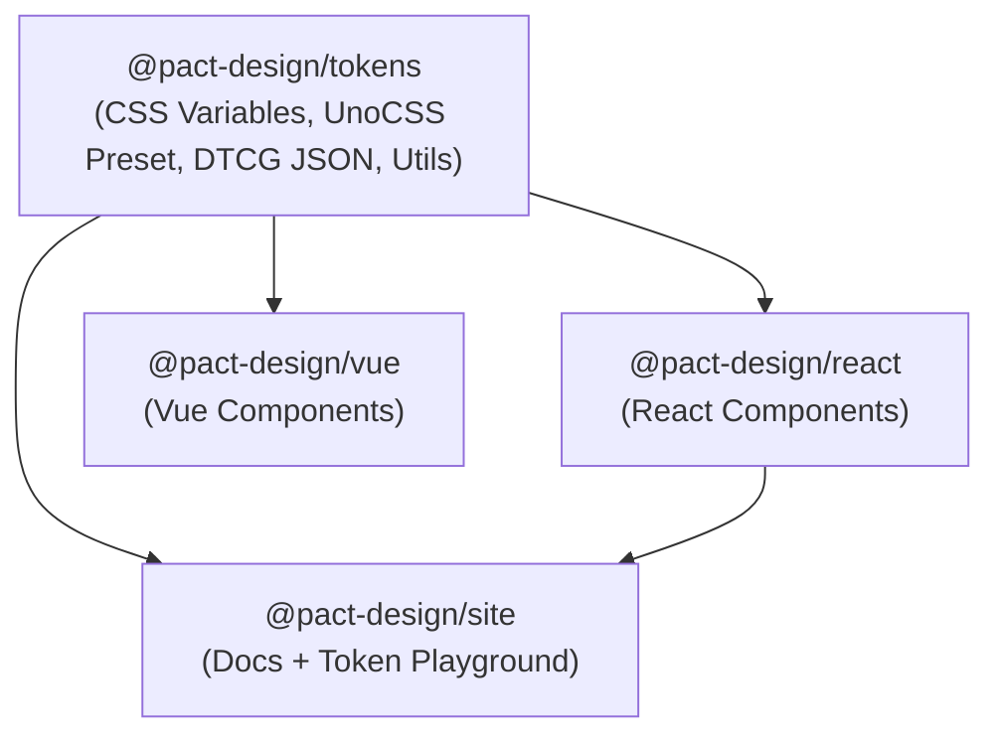

# Pact Design — Monorepo Structure & Architecture Decision

This document records the repository structure decision for **Pact Design** as it expands from a design-token library with a documentation site into a multi-package design system (`tokens`, `react`, `vue`, and `site`).

---

## 1. Decision Summary

We adopt the **Standard `packages/*` Monorepo Layout** managed by **`pnpm` workspaces** inside a **single Git repository**:

- **Root directory (`Pact-Design/`)**: Strictly a private workspace orchestrator (`"private": true`) managing repo-wide scripts, linting, and lockfiles—never published to npm.
- **`packages/*`**: Contains all **publishable** npm packages (`@pact-design/tokens`, `@pact-design/react`, `@pact-design/vue`).
- **`site/` & `docs/`**: Contains **internal/non-published** documentation specifications (`docs/`) and the interactive web application (`site/`).

---

## 2. Target Repository Structure

```txt
Pact-Design/
├── package.json                 # {"private": true} — Workspace scripts & shared devDependencies (ESLint)
├── pnpm-workspace.yaml          # Workspace package discovery: ['site', 'packages/*']
├── pnpm-lock.yaml               # Unified lockfile for the entire monorepo
├── .npmrc                       # Workspace configuration (strict pnpm linking)
├── eslint.config.js             # Unified flat ESLint configuration
├── docs/                        # Shared W3C DTCG & system specification MDX files
│   ├── spec/                    # Interactive documentation MDX pages
│   ├── token.md                 # Token architecture reference
│   ├── roadmap.md               # Project roadmap
│   └── repo-structure.md        # Monorepo architecture decision record (this file)
├── site/                        # @pact-design/site — Online docs & Token Playground ("private": true)
│   ├── package.json
│   ├── vite.config.js
│   ├── uno.config.js
│   └── src/
└── packages/                    # All publishable npm packages live here
    ├── tokens/                  # @pact-design/tokens
    │   ├── package.json         # exports: "./css", "./uno", "./tokens/*", "./utils/*"
    │   ├── src/                 # W3C DTCG 2025.10 JSON files (border, color, elevation, motion, sizing, spacing, typography)
    │   ├── scripts/             # Style Dictionary config (sd.config.js) & UnoCSS preset generator (unoCss.js)
    │   ├── utils/               # Isomorphic color, APCA/WCAG contrast, and DTCG token utilities
    │   ├── test/                # Automated APCA contrast & token schema tests
    │   └── build/               # Generated outputs (_variables.css, uno/preset.js)
    ├── react/                   # @pact-design/react — React component library
    │   ├── package.json
    │   └── src/
    └── vue/                     # @pact-design/vue — Vue component library
        ├── package.json
        └── src/
```

---

## 3. Why We Chose This Structure

### 3.1 Clear Boundary Between Publishable Packages and Internal Apps

Grouping all publishable artifacts under `packages/*` while keeping `site/` and `docs/` outside `packages/*` makes it immediately obvious what gets published to npm vs. what is internal infrastructure. Release and versioning tools (such as Changesets) and CI publish pipelines can target `packages/*` with a single glob without accidentally publishing the documentation site.

### 3.2 Private Workspace Root (Eliminating the "Root-as-Package" Anti-Pattern)

Previously, the root `package.json` acted as both the monorepo root and the published `pact-design` package, while `site/` depended back on the root via `"pact-design": "workspace:*"`. Moving the token library into `packages/tokens` and marking the root `package.json` as `"private": true` resolves several issues:

- **No dependency leakage**: Repo-wide dev tools (like `eslint` and `@stylistic/eslint-plugin`) stay in the root `devDependencies` and can never leak into a published package's runtime `dependencies`.
- **No parent-child dependency cycles**: Workspace children (`site`, `react`, `vue`) depend on a sibling (`@pact-design/tokens`), not on their own workspace root.
- **Clean `npm publish` surface**: Each package in `packages/*` defines its own `"files"` and `"exports"` without risking bundling root configs, `docs/`, or `site/`.

### 3.3 Self-Contained `@pact-design/tokens` Package

Rather than leaving `tokens/` as raw JSON files that rely on root scripts to build, `packages/tokens` encapsulates the entire token lifecycle:

- Raw DTCG JSON definitions (`src/` or `tokens/`)
- Build pipeline (`scripts/sd.config.js`, `scripts/unoCss.js`)
- Isomorphic utilities (`utils/color.js`, `utils/contrast.js`, `utils/token.js`, `utils/helper.js`)
- Automated verification gate (`test/contrast.test.js`)
- Compiled distribution (`build/css/_variables.css`, `build/uno/preset.js`)

This allows `@pact-design/react`, `@pact-design/vue`, and `@pact-design/site` to consume tokens, CSS variables, UnoCSS presets, and color utilities through clean package entrypoints (`@pact-design/tokens/css`, `@pact-design/tokens/uno`, `@pact-design/tokens/utils/*`).

### 3.4 Single Git Repository vs. Multi-Repo / Submodules

All packages (`site`, `packages/tokens`, `packages/react`, `packages/vue`) live inside **one Git repository** (`Pact-Design/.git`) rather than separate Git repositories or submodules:

- **Atomic changes**: A single pull request can add a new token in `packages/tokens`, consume it in `packages/react` and `packages/vue`, and document it in `site/` and `docs/`.
- **Single lockfile**: One `pnpm-lock.yaml` at the root ensures consistent dependency versions (React, Vite, UnoCSS, ESLint) across the entire workspace.
- **Zero-publish local linking**: Changes in `packages/tokens` are immediately available to `packages/react`, `packages/vue`, and `site/` via `"workspace:*"`.

### 3.5 Lowercase Directory Naming for Cross-OS Safety

All workspace package directories use strict lowercase names (`packages/react`, `packages/vue`, `packages/tokens`). While macOS uses a case-insensitive filesystem by default, Linux CI/CD runners and production build containers are strictly case-sensitive. Lowercase naming prevents broken import paths across environments.

---

## 4. Package Dependency Graph & Scoping

All workspace packages share the `@pact-design/*` namespace:



| Package | Directory | Published to npm? | Internal Dependencies |
| :--- | :--- | :---: | :--- |
| `@pact-design/tokens` | `packages/tokens` | Yes | None |
| `@pact-design/react` | `packages/react` | Yes | `@pact-design/tokens` (`workspace:*`) |
| `@pact-design/vue` | `packages/vue` | Yes | `@pact-design/tokens` (`workspace:*`) |
| `@pact-design/site` | `site` | No (`private: true`) | `@pact-design/tokens`, `@pact-design/react` (`workspace:*`) |

---

## 5. Workspace Configuration Standards

### 5.1 `pnpm-workspace.yaml`

```yaml
packages:
  - 'site'
  - 'packages/*'
```

### 5.2 Root `package.json`

The root `package.json` is strictly an orchestrator:

```json
{
  "name": "pact-design-monorepo",
  "private": true,
  "type": "module",
  "scripts": {
    "build": "pnpm --filter @pact-design/tokens build && pnpm --filter './packages/*' build",
    "build:tokens": "pnpm --filter @pact-design/tokens build",
    "test": "pnpm -r test",
    "lint": "eslint .",
    "site:dev": "pnpm --filter @pact-design/site dev",
    "site:build": "pnpm build:tokens && pnpm --filter @pact-design/site build",
    "site:preview": "pnpm --filter @pact-design/site preview"
  },
  "devDependencies": {
    "@eslint/js": "^10.0.1",
    "@stylistic/eslint-plugin": "^5.10.0",
    "eslint": "^10.8.1"
  }
}
```

### 5.3 `.npmrc`

Avoid `node-linker=hoisted` so `pnpm` enforces strict package boundaries (preventing `react`, `vue`, or `site` from accidentally importing undeclared phantom dependencies):

```ini
auto-install-peers=true
```

---

## 6. Monorepo Tooling Strategy (Why Not Nx Today?)

### Current Stage: Native `pnpm` Workspaces

We intentionally avoid heavy monorepo orchestrators like **Nx** at this stage:

- **Fast builds**: Building `@pact-design/tokens` (Style Dictionary + APCA contrast test suite) takes `<1s`. Distributed task caching from Nx adds configuration overhead (`nx.json`, `.nx/` cache daemon) without meaningful time savings.
- **Simple topological graph**: `pnpm --filter` and `pnpm -r` natively handle dependency-ordered execution across `@pact-design/tokens` → `@pact-design/{react,vue,site}`.

### Future Tooling Milestones

1. **When publishing packages to npm → Add [Changesets (`@changesets/cli`)](https://github.com/changesets/changesets)**:
   Manages semantic versioning, changelogs, and coordinated releases across `@pact-design/tokens`, `@pact-design/react`, and `@pact-design/vue`.
2. **When total build/test times exceed ~30–60s → Add [Turborepo](https://turbo.build/)**:
   If building `tokens` + `react` + `vue` + `site` grows slow in CI, add a lightweight `turbo.json` on top of `pnpm` workspaces for task pipelines (`"dependsOn": ["^build"]`) and local/remote build caching.

---

## 7. Migration Checklist (From Current Hybrid Root to `packages/*`)

- [ ] Create `packages/tokens/` and move `tokens/`, `scripts/`, `utils/`, `test/`, and `build/` into `packages/tokens/`.
- [ ] Create `packages/tokens/package.json` (`name: "@pact-design/tokens"`) with `"files": ["build", "tokens", "utils"]` and `"exports"` for `./css`, `./uno`, `./tokens/*`, and `./utils/*`.
- [ ] Convert root `package.json` to `"private": true`, remove `"exports"` and `"main"`, and keep only root orchestration scripts and ESLint `devDependencies`.
- [ ] Update `pnpm-workspace.yaml` to include `site` and `packages/*`.
- [ ] Remove `node-linker=hoisted` from `.npmrc`.
- [ ] Update imports in `site/` from `pact-design/*` to `@pact-design/tokens/*` (and configure Vite aliases in `site/vite.config.js` for raw token JSON / MDX doc globs).
- [ ] Scaffold `packages/react/` (`@pact-design/react`) and `packages/vue/` (`@pact-design/vue`) when component library implementation begins.
